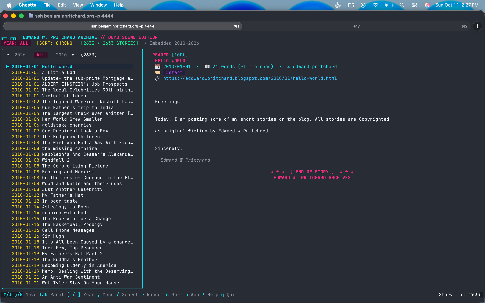

# Edward W. Pritchard: Stories Archive

A complete local Markdown archive of all stories from [Edward W. Pritchard's blog](https://eddwardwpritchard.blogspot.com/).

> "These are the short stories of Edward w Pritchard of Akron, Ohio. Stories are updated frequently and on many subjects. These stories are fiction with characters, dates and places sometimes based upon fact or having real life names or characters. But it is always just fiction, story telling."

## Archive Overview

- **Total Stories:** 2631
- **Date Range:** 2010-01-01 to 2026-07-13
- **Years Active:** 17 years (2010 – 2026)
- **Full Catalog:** See [INDEX.md](INDEX.md) for the searchable chronological list.

## Terminal TUI & Live SSH Access

You can browse and read the entire collection of Edward W. Pritchard's stories directly in your terminal using the interactive **ed-tui** reader.

### Instant SSH Access (Zero Login Required)

The reader is hosted live and publicly accessible over SSH with **no passwords, accounts, or SSH keys required**. Just open your terminal and connect:

```bash
ssh benjaminpritchard.org -p 4444
```

*(Or `ssh -p 4444 benjaminpritchard.org`)*



### How It Works: Go, Bubble Tea, & Wish

For folks curious about the tech stack:
- **Terminal User Interfaces in Go**: The Go ecosystem has world-class libraries for building rich, reactive console applications, led by Charmbracelet's **[Bubble Tea](https://github.com/charmbracelet/bubbletea)** (a terminal framework built around The Elm Architecture) and **[Lip Gloss](https://github.com/charmbracelet/lipgloss)** (declarative terminal styling and layout).
- **Serving TUIs over SSH with Wish**: Traditional SSH servers (like OpenSSH) authenticate user credentials to spawn shell sessions like `bash` or `zsh`. **[Wish](https://github.com/charmbracelet/wish)** is an SSH server library in Go developed by Charmbracelet that does something different: upon connection, it spins up a virtual pseudo-terminal (PTY) and hooks the incoming session directly into a Bubble Tea TUI application. No Unix accounts, authentication keys, or passwords are required.
- **A Creative Public Reading Experiment**: Benjamin Pritchard created and deployed this setup as a fun, creative experiment: taking Ed Pritchard's massive 17-year catalog of 2,633 short stories and making it immediately readable from any terminal anywhere in the world over SSH—with zero installation, zero friction, and a retro demoscene aesthetic.

### Key Navigation Shortcuts

| Key | Action |
| --- | --- |
| `↑` / `↓` or `k` / `j` | Navigate story list / scroll reader |
| `Tab` / `Shift+Tab` | Switch focus between Story List and Reader pane |
| `Enter` / `l` | Focus Reader / select item |
| `h` | Return focus to Story List |
| `/` | Live full-text & title search |
| `r` | 🎲 Demoscene random story roll |
| `[` / `]` or `←` / `→` | Cycle years (ALL, 2010..2026) |
| `y` | Open Year Picker menu |
| `s` | Toggle sort order (Chrono vs Newest) |
| `o` | Open original story in web browser |
| `q` / `Ctrl+C` | Quit |

### Running Locally

You can also run or compile the standalone TUI locally on your machine:

```bash
cd apps/tui

# Build standalone binary with all stories embedded:
make build

# Launch the reader:
./ed-tui
```

All 2,633 stories are embedded directly into the executable via Go's `embed.FS`, creating a single, fully offline binary. See [apps/tui/README.md](apps/tui/README.md) for more details.


## Stories by Year

| Year | Stories | Year Index |
| --- | --- | --- |
| 2010 | 523 | [Browse 2010 Stories](2010/README.md) |
| 2011 | 484 | [Browse 2011 Stories](2011/README.md) |
| 2012 | 173 | [Browse 2012 Stories](2012/README.md) |
| 2013 | 315 | [Browse 2013 Stories](2013/README.md) |
| 2014 | 359 | [Browse 2014 Stories](2014/README.md) |
| 2015 | 197 | [Browse 2015 Stories](2015/README.md) |
| 2016 | 82 | [Browse 2016 Stories](2016/README.md) |
| 2017 | 84 | [Browse 2017 Stories](2017/README.md) |
| 2018 | 84 | [Browse 2018 Stories](2018/README.md) |
| 2019 | 197 | [Browse 2019 Stories](2019/README.md) |
| 2020 | 40 | [Browse 2020 Stories](2020/README.md) |
| 2021 | 41 | [Browse 2021 Stories](2021/README.md) |
| 2022 | 40 | [Browse 2022 Stories](2022/README.md) |
| 2023 | 7 | [Browse 2023 Stories](2023/README.md) |
| 2024 | 2 | [Browse 2024 Stories](2024/README.md) |
| 2025 | 1 | [Browse 2025 Stories](2025/README.md) |
| 2026 | 2 | [Browse 2026 Stories](2026/README.md) |

## Directory Structure

Stories are organized into directories by **Year** (`YYYY/`), with each story stored in a standalone Markdown file named `YYYY-MM-DD-<slug>.md`.

Each story file contains:
- **YAML Frontmatter**: title, published date, author, original URL, post ID, and categories.
- **Clean Markdown Body**: preserving paragraphs, dialogues, images, and formatting.

```
edward_w_pritchard_writings/
├── README.md           # This archive summary
├── INDEX.md            # Complete chronological catalog of all stories
├── changelog.md        # Project changelog
├── crawl.py            # Python crawler to sync or update posts
├── requirements.txt    # Python dependencies
├── raw_posts.json      # Cached JSON responses from Blogger
├── assets/             # Screenshots and media assets
├── apps/
│   ├── tui/            # Go/Bubbletea terminal reader & Wish SSH client
│   └── gh-pages/       # Static web archive for GitHub Pages
├── 2010/               # Stories published in 2010 (523 stories)
│   ├── README.md       # Table of contents for 2010
│   └── 2010-01-05-...md
├── ...
└── 2026/               # Stories published in 2026
    ├── README.md
    └── 2026-07-13-...md
```

## How to Update / Re-run Crawler

To re-crawl and sync new posts:
```bash
# Set up virtual environment
python3 -m venv .venv
source .venv/bin/activate
pip install -r requirements.txt

# Run crawler (fetches newly added stories if any)
python crawl.py --fetch
```
